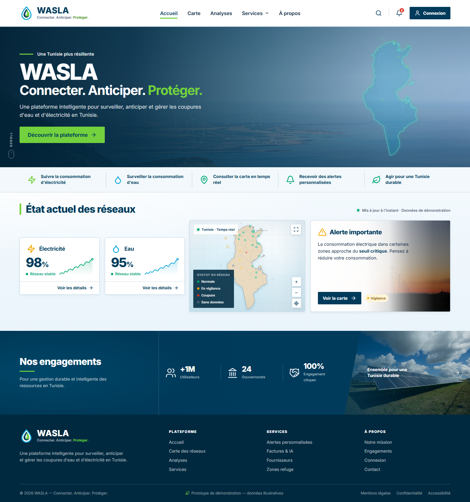

# WASLA – Connecter. Anticiper. Protéger.

Plateforme web pour **surveiller, anticiper et gérer les coupures d'eau et d'électricité en Tunisie**, développée à **Esprit School of Engineering** dans le cadre du Projet Technologies Web (2A6, 2026–2027).



## Table des matières

- [Overview](#overview)
- [Features](#features)
- [Tech Stack](#tech-stack)
- [Architecture](#architecture)
- [Sécurité](#sécurité)
- [Contributors](#contributors)
- [Academic Context](#academic-context)
- [Getting Started](#getting-started)
- [Usage](#usage)
- [Contributions](#contributions)
- [Acknowledgments](#acknowledgments)
- [Licence](#licence)

## Overview

This project was developed as part of the **Web Technologies Project – 2nd Year Engineering Program** at **Esprit School of Engineering** (Academic Year 2026–2027).

**Le problème.** En Tunisie, les coupures d'eau (SONEDE) et d'électricité (STEG) sont souvent mal annoncées : les citoyens ne savent ni quand elles commencent, ni quand elles finissent, ni où trouver de l'aide.

**La solution.** WASLA réunit sur une même plateforme les interruptions et signalements, les alertes, l'analyse des factures et de la consommation, des Refuge Zones proposées par des entreprises, et un réseau de solidarité (assistance, bénévoles, installations solaires, fournisseurs).

Le site comprend un **Front Office** (citoyens, entreprises, fournisseurs, bénévoles) et un **Back Office** (administrateur et sous-admins STEG / SONEDE).

## Features

| Module | Responsable | Branche | Contenu |
|---|---|---|---|
| Commun | équipe | `main` | Architecture MVC, connexion PDO, inscription / connexion / déconnexion, sessions, rôles, contrôle d'accès, CSRF, layouts FO / BO |
| 1 — Interruptions, signalements & alertes | Houssem Belhaj | `module1-interruptions` | Interruptions, signalements, alertes, zones — comptes sous-admins STEG / SONEDE |
| 2 — Analyse des factures & consommation | Hiba Bouzid | `module2-factures` | Factures, consommation, analyse — comptes citoyens |
| 3 — Refuge Zones | Louay Azzabi | `module3-refuges` | Refuge Zones, réservations — comptes entreprises |
| 4 — Assistance d'urgence, solaire & fournisseurs | Bechir Hellali | `module4-assistance` | Demandes d'assistance, réponses, fournisseurs — comptes fournisseurs, bénévoles, propriétaires |

**Base de données.** Un seul script, `database/wasla.sql`, créé par un membre et partagé par toute l'équipe : 18 tables reliées par 34 clés étrangères.

| Partie | Tables |
|---|---|
| Commun | `zone`, `utilisateur`, `notification` |
| Module 1 | `interruption`, `signalement`, `confirmation`, `alerte`, `lieu_suivi`, `preference_alerte` |
| Module 2 | `facture`, `consommation`, `analyse_facture` |
| Module 3 | `refuge_zone`, `reservation_refuge` |
| Module 4 | `installation_solaire`, `demande_assistance`, `reponse`, `personne_prioritaire` |

**Gestion des utilisateurs.** Une seule table `utilisateur` ; le rôle est une colonne (`citoyen`, `admin`, `steg`, `sonede`, `entreprise`, `fournisseur`, `benevole`, `proprietaire`). **Entreprise et fournisseur sont des rôles, pas des tables** : leurs informations (raison sociale, matricule fiscal, spécialité…) sont des colonnes facultatives de `utilisateur`. L'inscription publique crée toujours un compte `citoyen` ; les autres rôles sont attribués par l'administrateur. Chaque module gère les comptes de ses propres acteurs.

**Interface :** français / anglais / arabe (RTL), thème clair / sombre, recherche globale (`Ctrl+K`), responsive, accessibilité clavier.

## Tech Stack

### Frontend

- HTML5, CSS3, JavaScript (ES6, sans framework)
- Contrôle de saisie en JavaScript (`validation.js`), **sans validation HTML5**
- Icônes [Lucide](https://lucide.dev), polices Inter et IBM Plex Sans Arabic (hébergées localement)

### Backend

- PHP 8 — architecture **MVC** sans framework
- MySQL via **PDO** (requêtes préparées)

## Architecture

```text
├── index.php                  Point d'entrée unique : index.php?action=<clé>
├── config/
│   ├── database.php           Classe Database (Singleton) → Database::getConnexion()
│   └── helpers.php            Fonctions d'affichage : e(), url(), asset(), csrfField()…
├── models/                    UNIQUEMENT attributs privés + getters/setters + fromArray()
│   ├── UserModel.php
│   └── ZoneModel.php
├── controllers/               TOUTE la logique : SQL préparé, validation, sessions, rôles
│   ├── Controller.php         Classe de base : $this->db + validate()
│   ├── AuthController.php     Inscription, connexion, déconnexion, rôles, CSRF
│   └── ZoneController.php
├── routes/                    Un fichier par module : 'action' => function () { … }
│   ├── common.php             Accueil, inscription, connexion, mon-compte, dashboard
│   └── module1.php … module4.php
├── views/                     UNIQUEMENT de l'affichage (htmlspecialchars via e())
│   ├── frontoffice/           layout.php, partials/, pages/, assets/
│   └── backoffice/            layout.php, partials/, pages/, assets/
├── database/wasla.sql         Base complète (18 tables, 4 modules) — créée par un seul membre, partagée
└── docs/                      Guide de l'équipe, maquettes, captures
```

**Parcours d'une requête :**

```text
index.php?action=connexion
  → index.php : session sécurisée, en-têtes, vérification CSRF (POST)
  → routes/common.php : 'connexion' => function () { … }
  → AuthController::login($_POST)  (validation + requête préparée + password_verify)
  → views/frontoffice/pages/auth/connexion.php  (ob_start → $content)
  → views/frontoffice/layout.php  (head → navbar → $content → footer → scripts)
```

## Sécurité

Détails, tests à montrer et réponses aux questions de réflexion du workshop : [docs/SECURITE.md](docs/SECURITE.md).

**Sessions.** La session est créée par `session_start()` et reçoit un **nouvel identifiant** à la connexion (`session_regenerate_id(true)`). Ses données (`user_id`, `role`, heure de connexion…) restent sur le serveur ; le navigateur ne garde que l'identifiant, dans le cookie `PHPSESSID` (HttpOnly). Front Office et Back Office partagent la même session ; le Back Office est protégé par `requireRole()`. Rien de tout cela n'est affiché : la gestion des sessions est dans le code (`index.php`, `AuthController`).

| Risque | Protection | Où |
|---|---|---|
| Injection SQL | Requêtes préparées PDO, `ATTR_EMULATE_PREPARES = false` | contrôleurs, `config/database.php` |
| Mots de passe en clair | `password_hash()` / `password_verify()` | `AuthController` |
| XSS | `e()` = `htmlspecialchars()` sur chaque sortie, validation des entrées, CSP | vues, contrôleurs, `index.php` |
| CSRF | Jeton par session dans chaque formulaire, vérifié pour **tout** POST avec `hash_equals()` | `index.php`, `csrfField()` |
| Fixation de session | `session_regenerate_id(true)` après connexion | `AuthController::login()` |
| Vol de session | Cookie `HttpOnly`, `SameSite=Lax`, `use_strict_mode` | `index.php` |
| Clickjacking | `X-Frame-Options: DENY` | `index.php` |
| Élévation de privilèges | Rôle forcé à l'inscription, `requireRole()` sur chaque action sensible, rôle relu en base à chaque requête | `AuthController`, `routes/` |
| Force brute | Blocage de 60 s après 5 échecs de connexion | `AuthController::login()` |
| Sessions abandonnées | Expiration après 30 min d'inactivité | `index.php` |

## Contributors

| Membre | Module | GitHub |
|---|---|---|
| Houssem Belhaj | Module 1 — Interruptions, signalements & alertes | [@iForgotTheSemicolonAgainlol](https://github.com/iForgotTheSemicolonAgainlol) |
| Hiba Bouzid | Module 2 — Analyse des factures & consommation | [@hibabouzid](https://github.com/hibabouzid) |
| Louay Azzabi | Module 3 — Refuge Zones | à compléter |
| Bechir Hellali | Module 4 — Assistance d'urgence, solaire & fournisseurs | [@MohamedBechirHelali](https://github.com/MohamedBechirHelali) |

## Academic Context

Developed at **Esprit School of Engineering – Tunisia**
Projet Technologies Web — 2A6 | 2026–2027

## Getting Started

### Prérequis

- PHP 8.0+ et MySQL 5.7+ / MariaDB 10.3+, via [Laragon](https://laragon.org), [XAMPP](https://www.apachefriends.org/fr/index.html) ou [WampServer](https://www.wampserver.com)
- Un navigateur récent

### Installation

1. Cloner le dépôt dans le dossier web (`C:\laragon\www`, `htdocs` ou `www`) :

   ```bash
   git clone https://github.com/<organisation>/<nom-du-depot>.git
   ```

2. Démarrer Apache et MySQL.
3. Dans **phpMyAdmin**, créer la base `wasla` (`utf8mb4_unicode_ci`), puis onglet **SQL** : coller tout `database/wasla.sql` et exécuter. Ce fichier unique crée les 18 tables des 4 modules et les données de démonstration.
4. Si votre MySQL a un mot de passe, le renseigner dans `config/database.php` (`DB_PASS`).
5. Ouvrir `http://localhost/<nom-du-depot>/index.php`.

### Comptes de démonstration

| Rôle | E-mail | Mot de passe |
|---|---|---|
| Super admin | `admin@wasla.tn` | `Admin@2026` |
| Sous-admin STEG | `steg@wasla.tn` | `Steg@2026` |
| Sous-admin SONEDE | `sonede@wasla.tn` | `Sonede@2026` |
| Citoyen | `citoyen@wasla.tn` | `Citoyen@2026` |
| Entreprise | `entreprise@wasla.tn` | `Demo@2026` |
| Fournisseur | `fournisseur@wasla.tn` | `Demo@2026` |
| Bénévole | `benevole@wasla.tn` | `Demo@2026` |
| Propriétaire solaire | `solaire@wasla.tn` | `Demo@2026` |

## Usage

| Page | Adresse | Accès |
|---|---|---|
| Accueil | `index.php?action=accueil` | public |
| Créer un compte | `index.php?action=inscription` | visiteur |
| Connexion | `index.php?action=connexion` | visiteur |
| Mon espace | `index.php?action=mon-compte` | connecté |
| Tableau de bord (Back Office) | `index.php?action=dashboard` | admin, STEG, SONEDE |

## Contributions

Voir [docs/GUIDE-EQUIPE.md](docs/GUIDE-EQUIPE.md) : branches, fichiers propres à chaque module, conventions de commits, fusion et GitHub Project.

## Acknowledgments

- Nos tuteurs du Projet Technologies Web à **Esprit School of Engineering**
- [Lucide](https://lucide.dev) (icônes, licence ISC), [geoBoundaries](https://www.geoboundaries.org) (contours des gouvernorats), [Inter](https://rsms.me/inter/) et [IBM Plex Sans Arabic](https://github.com/IBM/plex) (SIL Open Font License)

Les chiffres de démonstration affichés sont **fictifs**.

## Licence

Distribué sous la **licence MIT**. Voir [LICENSE](LICENSE).
